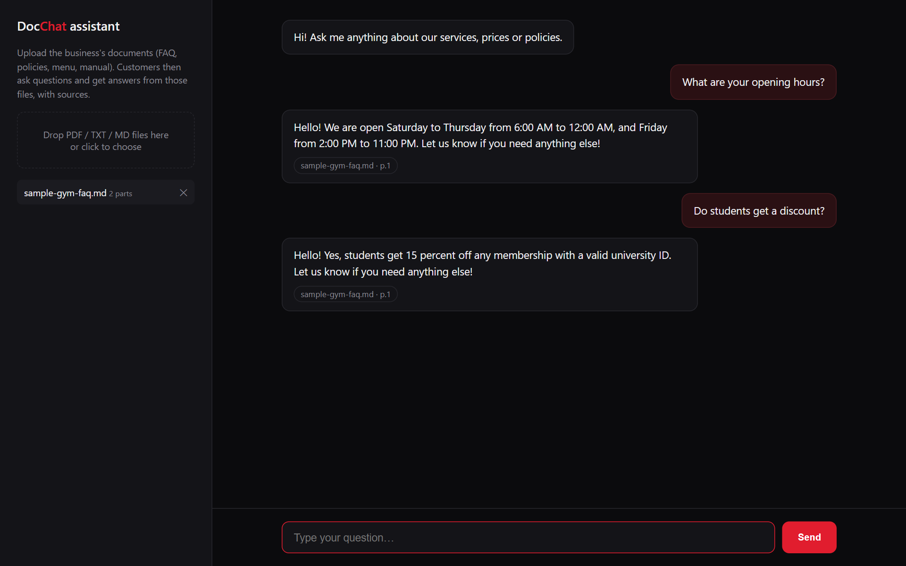

# Document Q&A Chatbot

A support chatbot that answers customer questions from a business's own documents (FAQ, policies,
price lists, manuals), with the source file and page shown under each answer. Built with FastAPI and Claude.



## Features
- Upload PDF, TXT or Markdown files from the browser; re-uploading a file replaces it.
- BM25 keyword retrieval - no vector database or embeddings to set up.
- Answers only from the documents, says "I don't know" otherwise, replies in the customer's language.
- Conversation memory (last 10 turns) and clear error messages.
- **Website chat bubble**: one line of HTML adds the assistant to any website (colour and title configurable).
- **Appointment requests**: visitors leave name, contact and preferred time; saved and emailed to the business.
- Admin lock (`ADMIN_TOKEN`) so only the owner can change documents, and one data folder per business.

## Add it to a website
```html
<script src="https://YOUR-SERVER/widget.js" data-title="Bright Smile Dental" data-color="#0a7c66" defer></script>
```
See it on a sample clinic site at `/demo`. Appointment requests: `GET /api/leads?token=...`.

## Run it
```
python -m venv .venv
.venv\Scripts\activate
pip install -r requirements.txt
set ANTHROPIC_API_KEY=your-key
set BUSINESS_NAME=Iron Zone Gym
uvicorn app.main:app --reload
```
Open http://localhost:8000 and upload `data/docs/sample-gym-faq.md` to try it.

## Settings (environment variables)
| Variable | Default | Meaning |
|---|---|---|
| `AI_PROVIDER` | claude if its key is set, else gemini | `claude` (paid, best answers) or `gemini` (Google free tier) |
| `ANTHROPIC_API_KEY` | - | Claude API key (for `claude`) |
| `GEMINI_API_KEY` | - | Free key from Google AI Studio (for `gemini`) |
| `GEMINI_MODEL` | gemini-3.5-flash-lite | Gemini model to use |
| `BUSINESS_NAME` | our company | Name the assistant speaks for |
| `CLAUDE_MODEL` | claude-opus-5-5 | Claude model to use |
| `DATA_DIR` | data | Folder for this business's documents, index and leads |
| `ADMIN_TOKEN` | - | If set, uploading/removing documents and reading leads need `?token=` |
| `EXTRA_INSTRUCTIONS` | - | Extra rules for the assistant (tone, what to always mention) |
| `LEAD_EMAIL` | - | Where appointment requests are emailed |
| `SMTP_HOST` / `SMTP_PORT` / `SMTP_USER` / `SMTP_PASSWORD` | - / 587 | Mail server for those emails (e.g. Gmail with an app password) |
